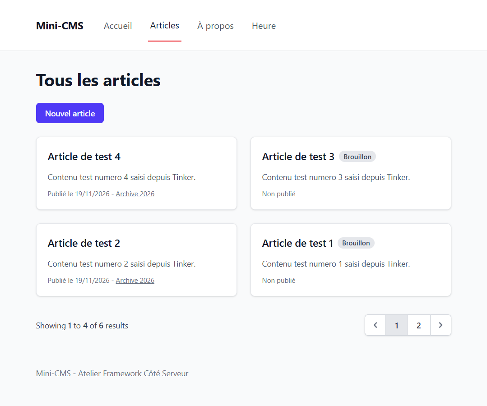
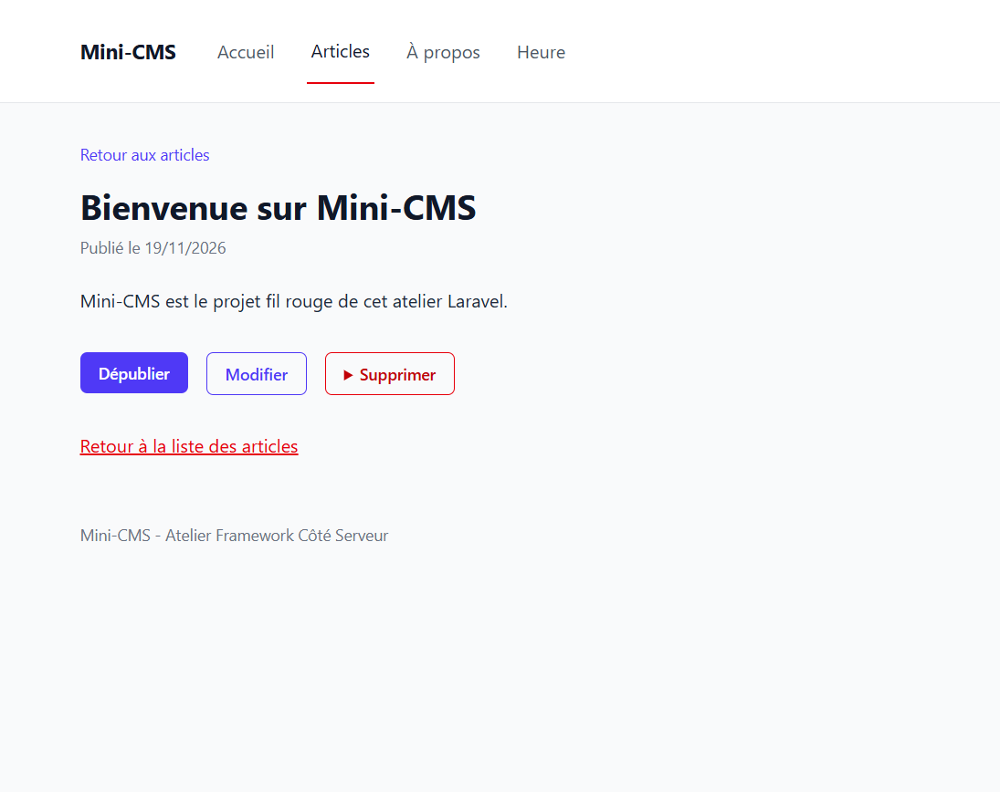
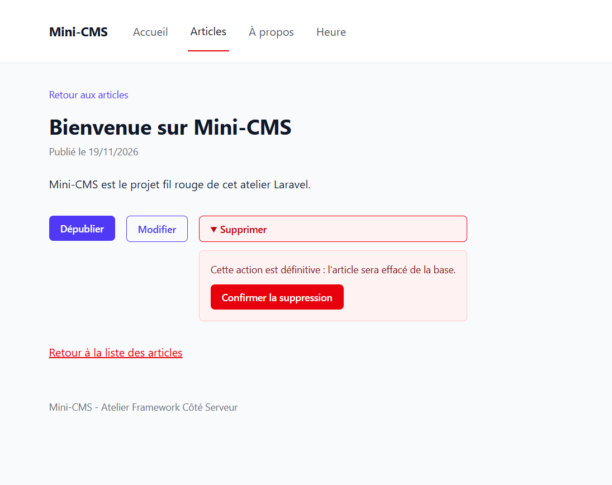
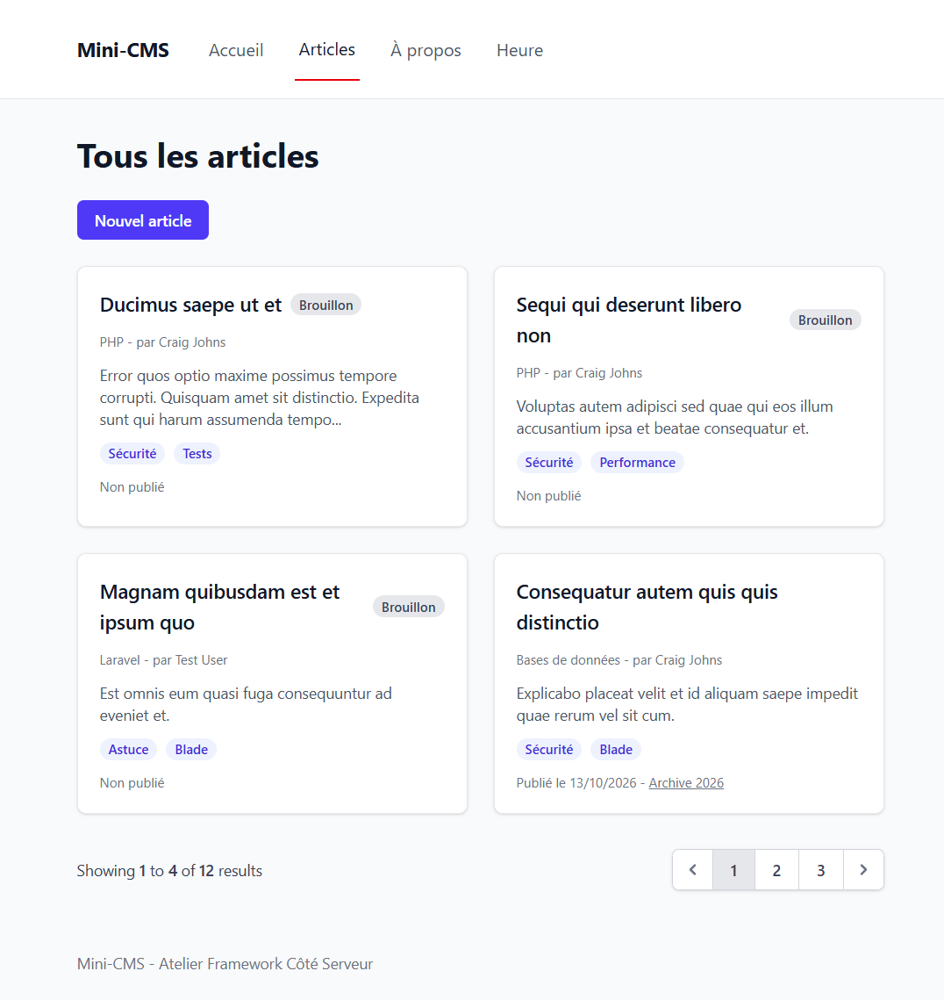
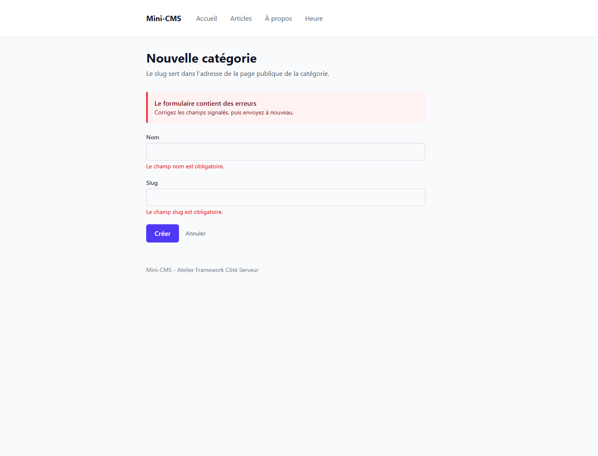

# Mini-CMS

Projet fil rouge de l'Atelier Framework Côté Serveur, construit avec Laravel 13, Blade, Tailwind CSS et SQLite.

## Installation locale

```powershell
composer install
if (-not (Test-Path .env)) { Copy-Item .env.example .env }
php artisan key:generate
if (-not (Test-Path database\database.sqlite)) { New-Item database\database.sqlite -ItemType File }
php artisan migrate
npm install
composer run dev
```

Les migrations créent les tables, dont `posts`. Les articles de démonstration sont des données locales et ne sont pas incluses dans le dépôt.

## État actuel (tag lab-05b)

- Back-office des catégories et des tags sous `/admin` (`CategoryController`, `TagController`), protégé par le middleware `writable`, avec Form Requests et messages flash.
- Messages de validation en français (`lang/fr/validation.php`, `APP_LOCALE=fr`), avec des noms de champs lisibles et des messages propres aux slugs des catégories et des tags.
- Pages 404 et 503 affichées dans le layout du site ; pages dédiées pour les articles et catégories introuvables.
- Tests Pest : `PostPagesTest`, `PostWriteTest`, `PostRelationsTest`, `PostTaxonomyTest`, `PostFeedbackTest`, `CategoryAdminTest`, `TagAdminTest` et `ErrorPagesTest`.

## Données de démonstration

Après un clone, reconstruire la base avec `php artisan migrate:fresh --seed`. Attention : cette commande vide la base avant de la remplir.

## Routes disponibles

| Méthode | URI | Nom | Action |
|---|---|---|---|
| GET | `/` | `home` | `PageController@home` |
| GET | `/a-propos` | `about` | `PageController@about` |
| GET | `/heure` | `time` | `PageController@time` |
| GET | `/posts` | `posts.index` | `PostController@index` |
| GET | `/posts/archive/{year}` | `posts.archive` | `PostController@archive` |
| GET | `/posts/categorie/{category:slug}` | `posts.category` | `PostController@byCategory` |
| GET | `/posts/tag/{tag:slug}` | `posts.tag` | `PostController@byTag` |
| GET | `/posts/create` | `posts.create` | `PostController@create` |
| POST | `/posts` | `posts.store` | `PostController@store` |
| GET | `/posts/{post}` | `posts.show` | `PostController@show` |
| GET | `/posts/{post}/edit` | `posts.edit` | `PostController@edit` |
| PUT | `/posts/{post}` | `posts.update` | `PostController@update` |
| DELETE | `/posts/{post}` | `posts.destroy` | `PostController@destroy` |
| PATCH | `/posts/{post}/publication` | `posts.publication` | `PostController@togglePublication` |
| GET | `/admin/categories` | `admin.categories.index` | `CategoryController@index` |
| GET | `/admin/categories/create` | `admin.categories.create` | `CategoryController@create` |
| POST | `/admin/categories` | `admin.categories.store` | `CategoryController@store` |
| GET | `/admin/categories/{category}/edit` | `admin.categories.edit` | `CategoryController@edit` |
| PUT | `/admin/categories/{category}` | `admin.categories.update` | `CategoryController@update` |
| DELETE | `/admin/categories/{category}` | `admin.categories.destroy` | `CategoryController@destroy` |
| GET | `/admin/tags` | `admin.tags.index` | `TagController@index` |
| GET | `/admin/tags/create` | `admin.tags.create` | `TagController@create` |
| POST | `/admin/tags` | `admin.tags.store` | `TagController@store` |
| GET | `/admin/tags/{tag}/edit` | `admin.tags.edit` | `TagController@edit` |
| PUT | `/admin/tags/{tag}` | `admin.tags.update` | `TagController@update` |
| DELETE | `/admin/tags/{tag}` | `admin.tags.destroy` | `TagController@destroy` |

## Vérifications

```powershell
php artisan migrate:status
php artisan route:list --except-vendor
php artisan test
npm run build
```

## Captures




### Session 06





### Session 07




### Session 09


### Session 10

Back-office des catégories et des tags, messages de validation en français, pages 404 et 503 dans le layout du site.




