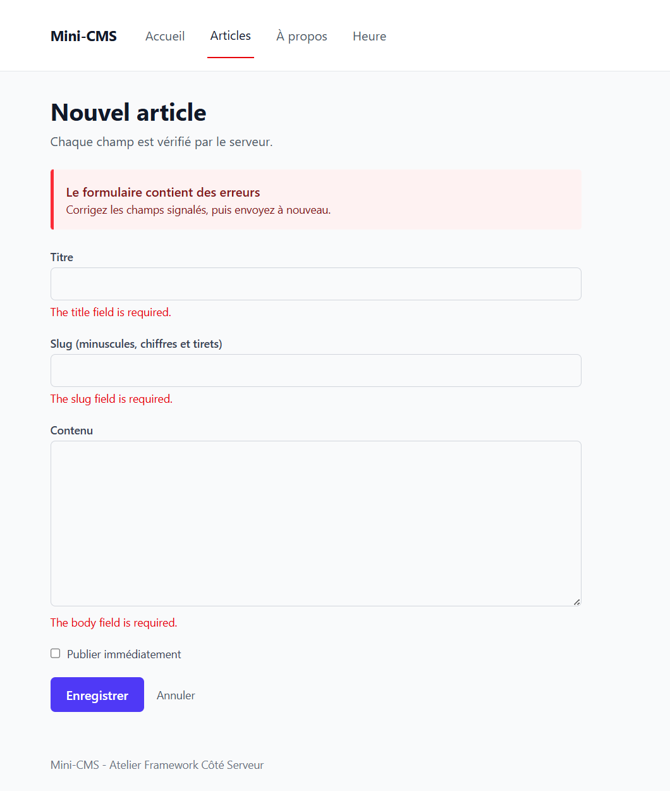
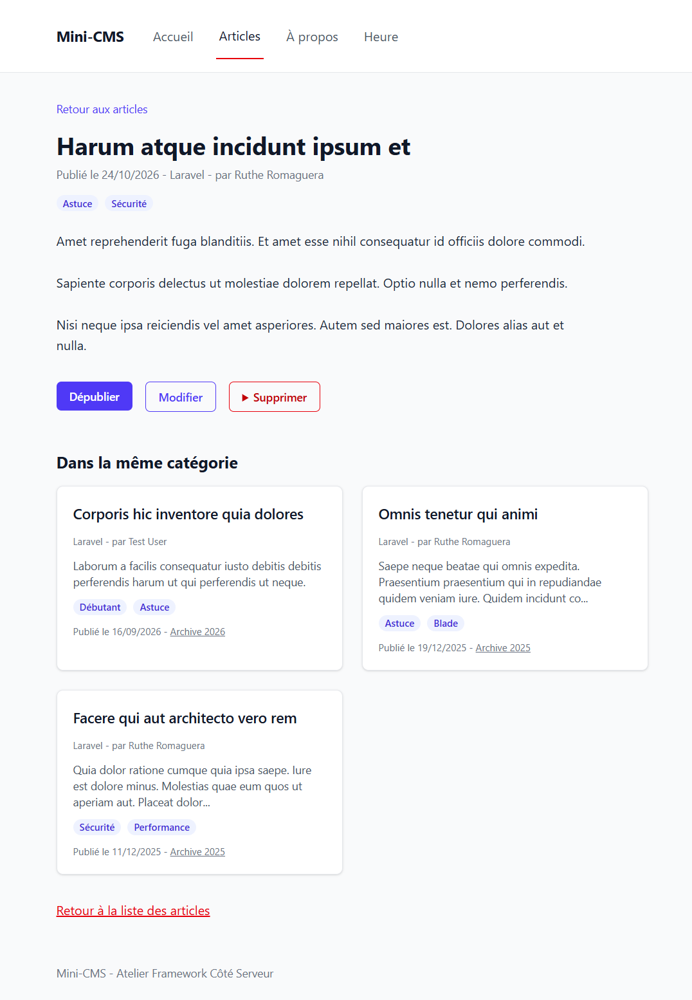
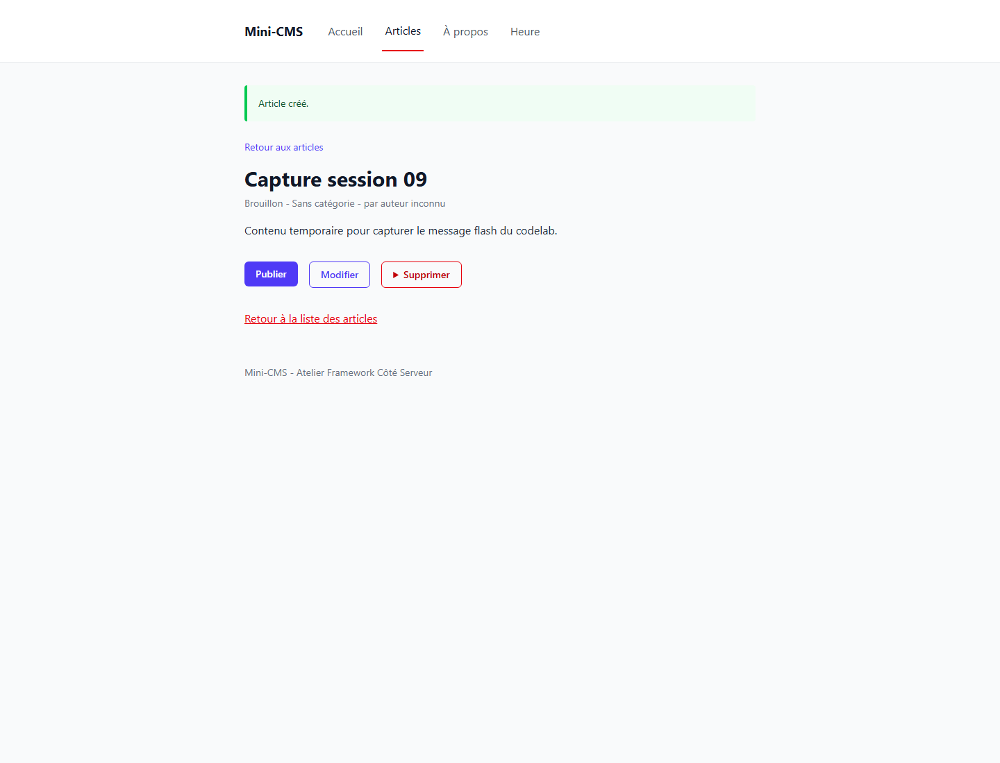
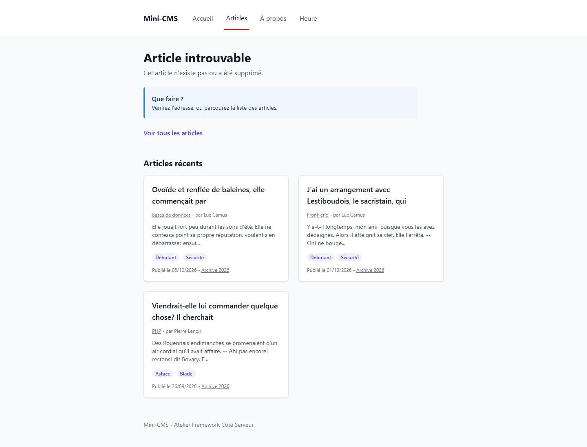
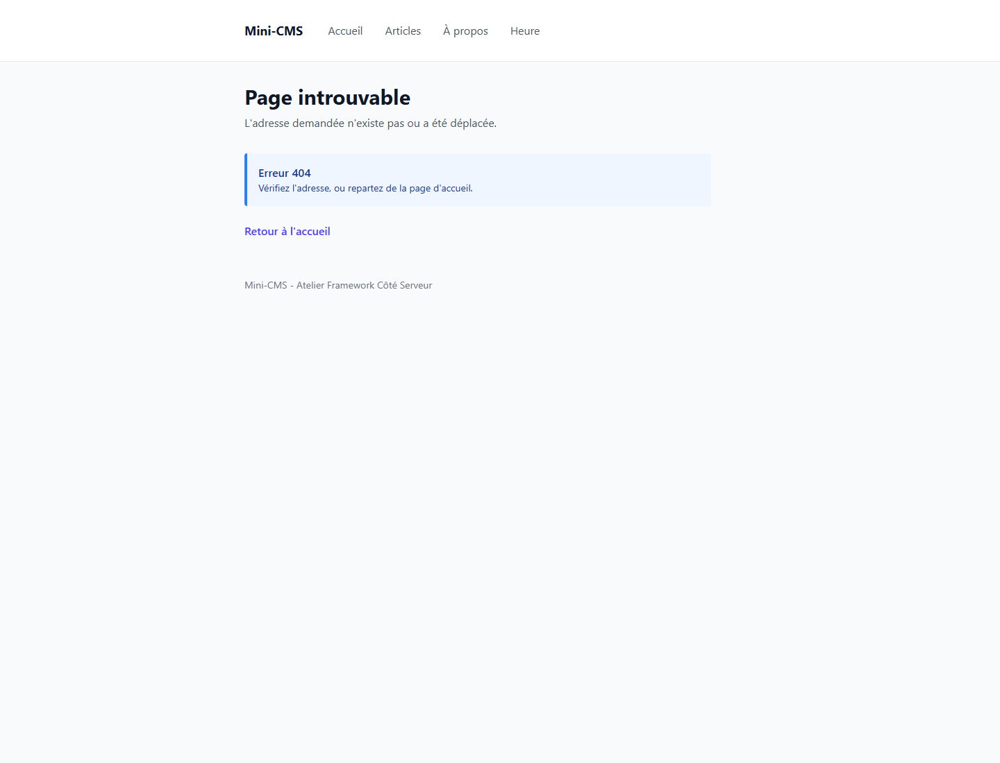
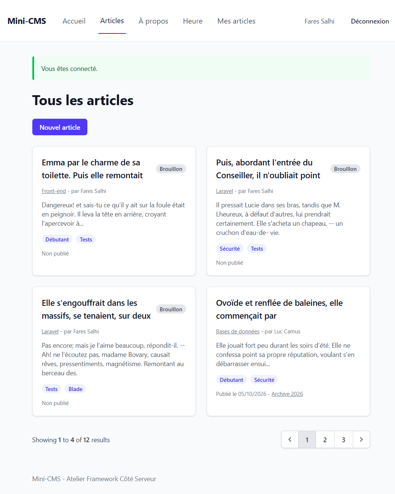
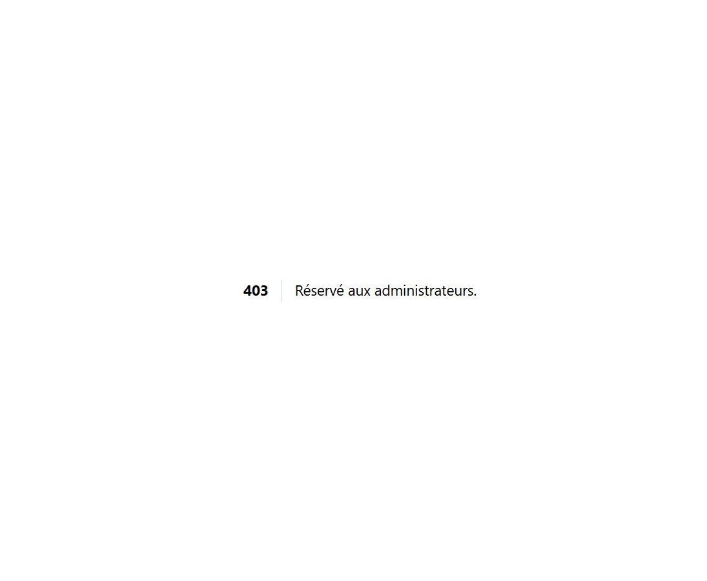
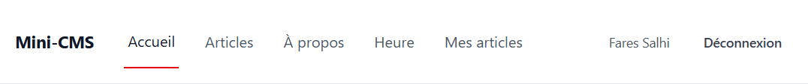

# Mini-CMS

Projet fil rouge de l'Atelier Framework Côté Serveur, construit avec Laravel 13, Blade, Tailwind CSS et SQLite.

## Installation locale

```powershell
composer install
if (-not (Test-Path .env)) { Copy-Item .env.example .env }
php artisan key:generate
if (-not (Test-Path database\database.sqlite)) { New-Item database\database.sqlite -ItemType File }
php artisan migrate
npm install
composer run dev
```

Les migrations créent les tables, dont `posts`. Les articles de démonstration sont des données locales et ne sont pas incluses dans le dépôt.

## État actuel (tag lab-06b)

- Inscription, connexion et déconnexion écrites à la main, avec mots de passe hachés, régénération de session et limitation des tentatives.
- Le rôle `author` est attribué par défaut ; `fares.salhi@example.com` est administrateur après `php artisan migrate:fresh --seed`.
- Le middleware `admin` protège toute la zone `/admin` ; les auteurs reçoivent une page 403.
- Les Gates `manage-categories` et `manage-tags` protègent contrôleurs, Form Requests et menu.
- Les brouillons ne sont visibles que par leur auteur et les administrateurs ; les articles publiés restent publics.
- Le défi de gestion des rôles permet aux administrateurs de promouvoir ou rétrograder un autre utilisateur, mais pas de modifier leur propre rôle.
- `/mes-articles` liste les articles et brouillons de l'utilisateur connecté ; la connexion propose « Se souvenir de moi ».
- Le README compare l'authentification manuelle au starter kit Livewire.
- Tests Pest : `PostPagesTest`, `PostWriteTest`, `PostRelationsTest`, `PostTaxonomyTest`, `PostFeedbackTest`, `CategoryAdminTest`, `TagAdminTest`, `ErrorPagesTest`, `AuthTest`, `AuthorizationTest`, `AdminAccessTest`, `PostVisibilityTest` et `UserRoleTest`.

## Données de démonstration

Après un clone, reconstruire la base avec `php artisan migrate:fresh --seed`. Attention : cette commande vide la base avant de la remplir.

## Routes disponibles

| Méthode | URI | Nom | Action |
|---|---|---|---|
| GET | `/` | `home` | `PageController@home` |
| GET | `/a-propos` | `about` | `PageController@about` |
| GET | `/heure` | `time` | `PageController@time` |
| GET | `/posts` | `posts.index` | `PostController@index` |
| GET | `/posts/archive/{year}` | `posts.archive` | `PostController@archive` |
| GET | `/posts/categorie/{category:slug}` | `posts.category` | `PostController@byCategory` |
| GET | `/posts/tag/{tag:slug}` | `posts.tag` | `PostController@byTag` |
| GET | `/posts/create` | `posts.create` | `PostController@create` |
| POST | `/posts` | `posts.store` | `PostController@store` |
| GET | `/posts/{post}` | `posts.show` | `PostController@show` |
| GET | `/posts/{post}/edit` | `posts.edit` | `PostController@edit` |
| PUT | `/posts/{post}` | `posts.update` | `PostController@update` |
| DELETE | `/posts/{post}` | `posts.destroy` | `PostController@destroy` |
| PATCH | `/posts/{post}/publication` | `posts.publication` | `PostController@togglePublication` |
| GET | `/admin/categories` | `admin.categories.index` | `CategoryController@index` |
| GET | `/admin/categories/create` | `admin.categories.create` | `CategoryController@create` |
| POST | `/admin/categories` | `admin.categories.store` | `CategoryController@store` |
| GET | `/admin/categories/{category}/edit` | `admin.categories.edit` | `CategoryController@edit` |
| PUT | `/admin/categories/{category}` | `admin.categories.update` | `CategoryController@update` |
| DELETE | `/admin/categories/{category}` | `admin.categories.destroy` | `CategoryController@destroy` |
| GET | `/admin/tags` | `admin.tags.index` | `TagController@index` |
| GET | `/admin/tags/create` | `admin.tags.create` | `TagController@create` |
| POST | `/admin/tags` | `admin.tags.store` | `TagController@store` |
| GET | `/admin/tags/{tag}/edit` | `admin.tags.edit` | `TagController@edit` |
| PUT | `/admin/tags/{tag}` | `admin.tags.update` | `TagController@update` |
| DELETE | `/admin/tags/{tag}` | `admin.tags.destroy` | `TagController@destroy` |
| GET | `/admin/utilisateurs` | `admin.users.index` | `UserRoleController@index` |
| PATCH | `/admin/utilisateurs/{user}/role` | `admin.users.role` | `UserRoleController@updateRole` |
| GET | `/inscription` | `register` | `Auth\RegisterController@create` |
| POST | `/inscription` | `register.store` | `Auth\RegisterController@store` |
| GET | `/connexion` | `login` | `Auth\LoginController@create` |
| POST | `/connexion` | `login.store` | `Auth\LoginController@store` |
| POST | `/deconnexion` | `logout` | `Auth\LoginController@destroy` |
| GET | `/mes-articles` | `my-posts` | `PostController@myPosts` |

## Vérifications

```powershell
php artisan migrate:status
php artisan route:list --except-vendor
php artisan test
npm run build
```

## Captures




### Session 06


### Session 07




### Session 09





### Session 10

Back-office des catégories et des tags, messages de validation en français, pages 404 et 503 dans le layout du site.




### Session 11




### Session 12





## Comparaison avec le starter kit Livewire

| Critère | Mini-CMS (authentification manuelle) | Starter kit Livewire |
|---|---|---|
| Routes d'authentification | Déclarées dans `routes/web.php` | Enregistrées par Fortify |
| Inscription | `RegisterController`, `RegisterRequest` et vue Blade | Action `CreateNewUser` et formulaire Livewire |
| Connexion | `LoginController` et `LoginRequest` | Fortify et vue Livewire |
| Déconnexion | Le contrôleur invalide la session et régénère le jeton CSRF | Action Livewire dédiée |
| Limitation des tentatives | Cinq essais par minute, selon l'e-mail et l'adresse IP | Fournie par Fortify |
| Mot de passe oublié | Absent | Fonctionnalité de réinitialisation activée |
| Vérification de l'e-mail | Absente | Fonctionnalité, contrat `MustVerifyEmail` et middleware `verified` |
| Double authentification | Absente | Double authentification et passkeys disponibles |
| Rôles et autorisations | Rôles, Gates, `PostPolicy` et middleware `admin` écrits pour le projet | À définir pour les besoins de l'application |
| Tests | Tests Pest pour l'authentification, les rôles et les autorisations | Tests fournis par le kit, écrits avec PHPUnit |

Dans un vrai projet, je garderais Fortify et le starter kit pour les fonctions d'authentification éprouvées, comme la réinitialisation des mots de passe et la vérification des e-mails. Je conserverais les Gates, les Policies et les règles de rôle propres à l'application, car le kit ne les définit pas à notre place.
